# Тұлға

**Мектеп психологының әр оқушы туралы картасы: бәрі бір жерде, әр мұғалім пайдалана алады.**

Түркістандағы [Назарбаев Зияткерлік мектебі](https://www.nis.edu.kz/) үшін жасалған. Қазір алғашқы сыныппен сынақтан өтіп жатыр.

**[▶ Демоны ашу](https://aibekser.github.io/tulga-showcase/)**: психолог, мұғалім, куратор, директор орынбасары немесе әкімші ретінде кіріп, қарап шығыңыз.

[English version](README.md)

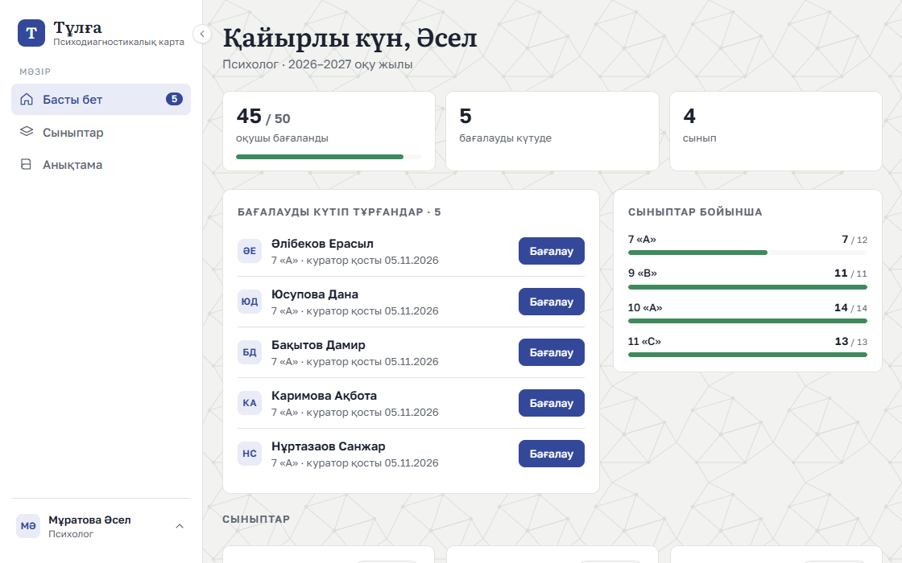

Суреттердегі барлық есім, балл мен мәтін ойдан шығарылған. Олар осы бетке арнайы жасалған демо мектептен алынды, сондықтан бірде-бір нақты оқушы немесе қызметкер көрсетілмейді.

## Мәселе

Мектеп психологы әр оқушыны бағалайды: темперамент, ақпаратты қабылдау типі, интеллект типі, тұлғалық тип және мотивация. Бұл сыныпқа кіретін әр мұғалімге пайдалы мәлімет.

Бірақ нәтижелер әр сыныпқа қолмен жасалған слайдтарда жатты. Мұғалімдер оларды сирек көретін, ал жаңа оқушы келгенде немесе жаңа оқу жылы басталғанда слайдтар ескіріп қалатын.

## Нәтиже

Психолог бағалауды бір рет енгізеді. Сынып диаграммалары, мұғалімдерге арналған ұсыныстар, басып шығаруға дайын профиль және келесі жылға ауысу соның негізінде жасалады. Әр мұғалім кез келген сыныпты аша алады.

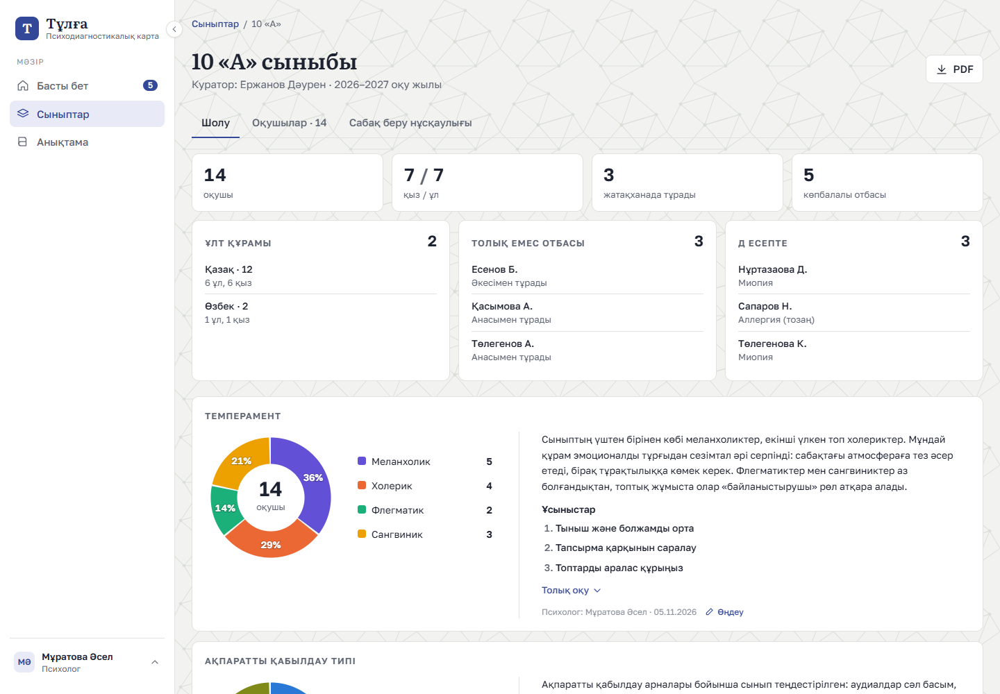

Қараңғы көрінісі бар, телефонда да жұмыс істейді.

## Кім қалай пайдаланады

### Психолог: «Кім күтіп тұр, мұғалімдерге не айтамын?»

Психологтың басты беті тапсырмалар тізімі сияқты: куратор қосқан, бірақ әлі бағаланбаған оқушылар. Формада бес тип пен мәтіндер толтырылады. Бір батырма таңдалған типтер бойынша үлгі мәтін қояды, психолог оны оқушыға сай түзетеді. Сынып диаграммаларының астындағы қорытындыны да психологтың өзі жазады, себебі сыныпты сол біледі.

<table>
  <tr>
    <td>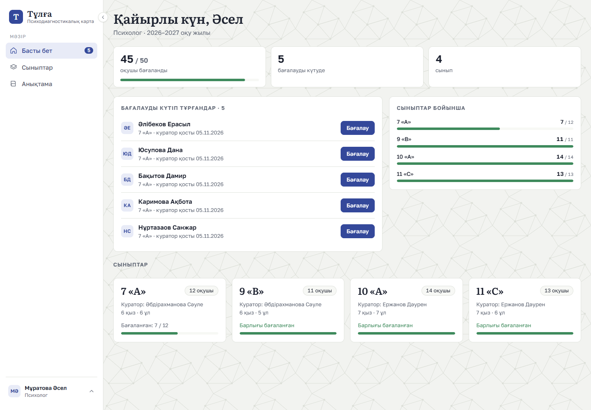</td>
    <td>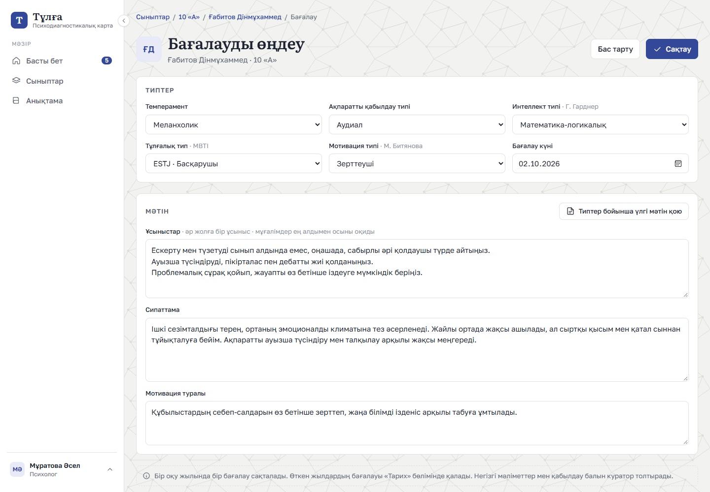</td>
  </tr>
</table>

### Мұғалім: «Сабаққа бес минут қалды»

Оқушы профилінде ең алдымен ұсыныстар тұрады, себебі сабақ алдында мұғалімге дәл сол керек. Сабақ беру нұсқаулығы бүкіл сыныпты қажеттілігіне қарай топтарға бөліп, әр топқа кеңес береді. Оны бір минутта оқып шығуға болады.

<table>
  <tr>
    <td>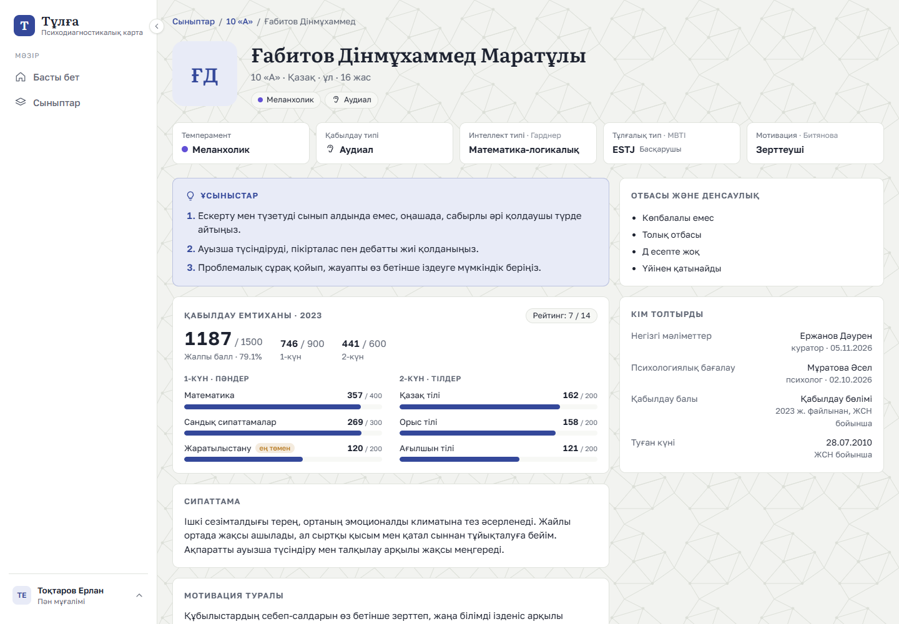</td>
    <td>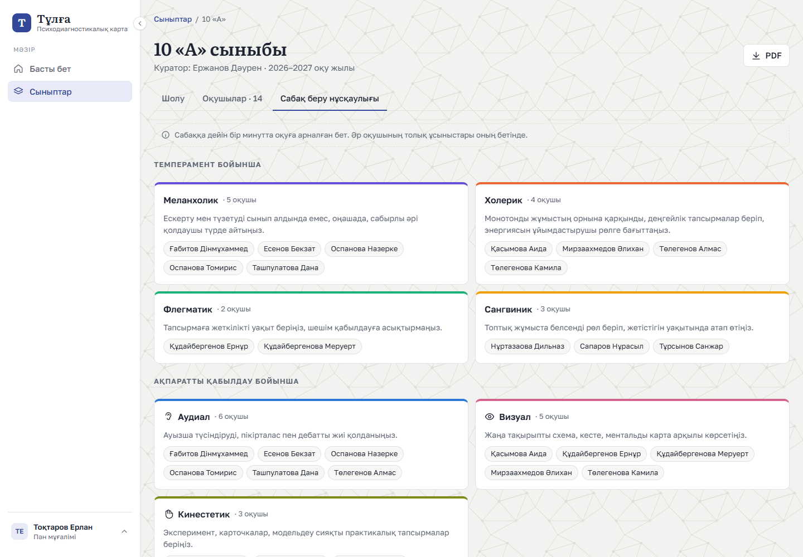</td>
  </tr>
</table>

### Куратор: «Сынып тізімі әрқашан дұрыс»

Куратор оқушыларды бір-бірден немесе бүкіл сыныпты Excel файлынан қосады. Ештеңе сақталмас бұрын әр жолды алдын ала көруге болады.

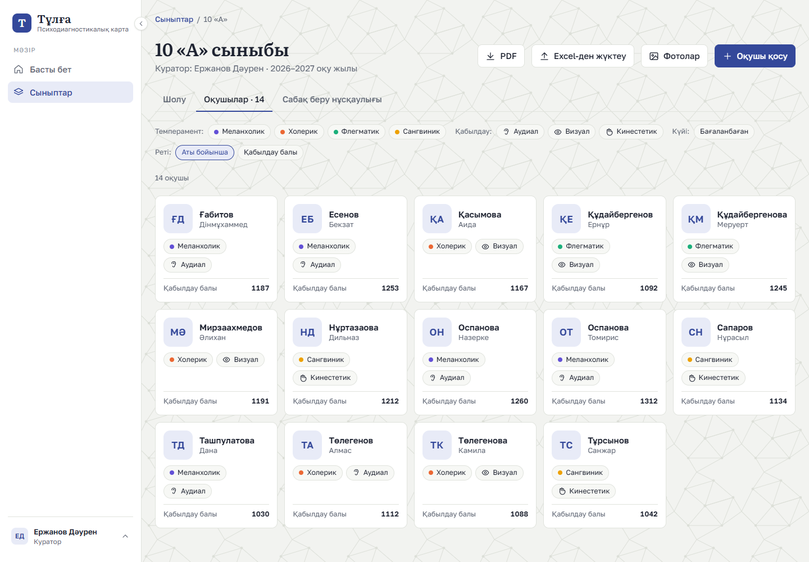

### Директор орынбасары: «Жиналысқа қағаз түрінде керек»

Бір батырма сынып бетін A4 құжатқа айналдырады: сынып құрамы, әр диаграмма психологтың толық қорытындысымен және әр оқушыға бір бет. Құжат мектептен шығатын болса, медициналық мәліметтерді алып тастауға болады.

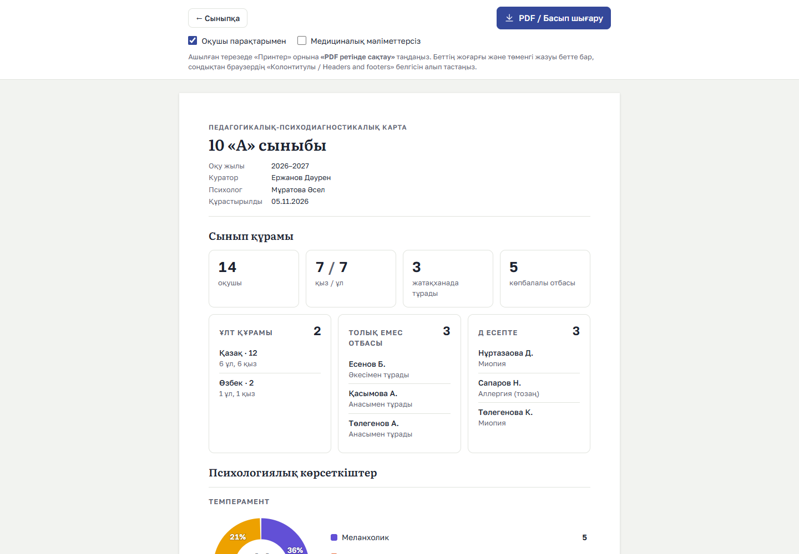

### Әкімші: қолжетімділік пен оқу жылы, бірақ профильдер емес

Тек тізімдегі адамдар мектеп аккаунтымен кіре алады. Әр кіру, ашылған профиль және өзгеріс журналға жазылады, оны ешкім өзгерте алмайды. Жыл соңында бір қадамдық рәсім барлық сыныпты бір сыныпқа жоғары көшіреді, ал ескі жыл тек оқуға арналған мұрағат болып қалады. Әкімші осының бәрін басқарады, бірақ бірде-бір оқушының профилін аша алмайды.

<table>
  <tr>
    <td>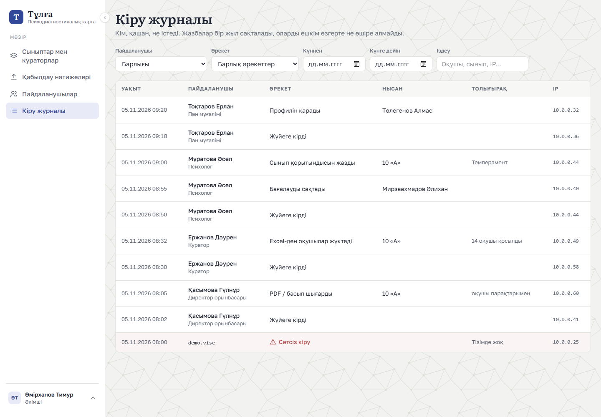</td>
    <td>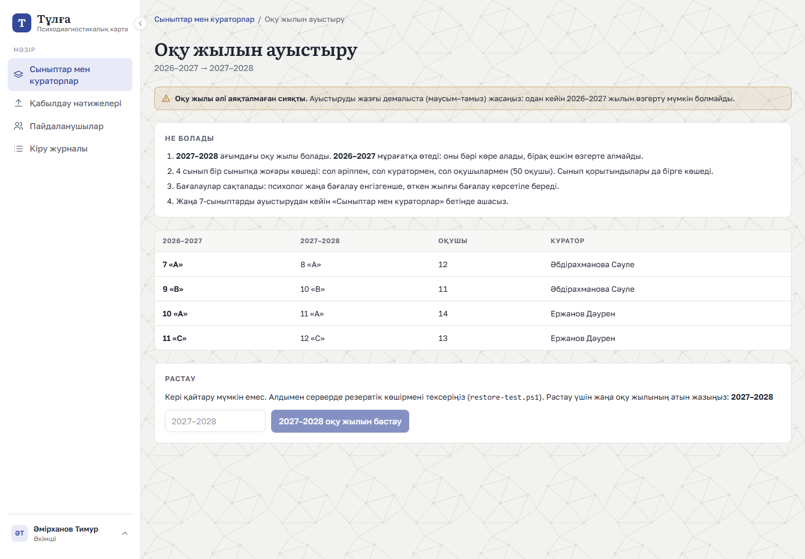</td>
  </tr>
</table>

<table>
  <tr>
    <td>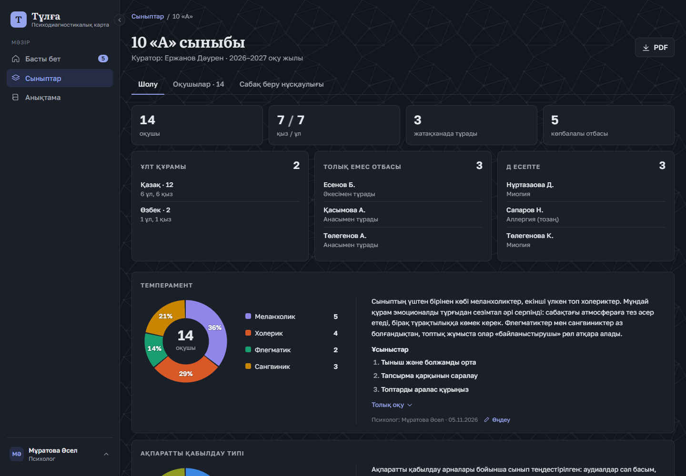</td>
    <td width="25%">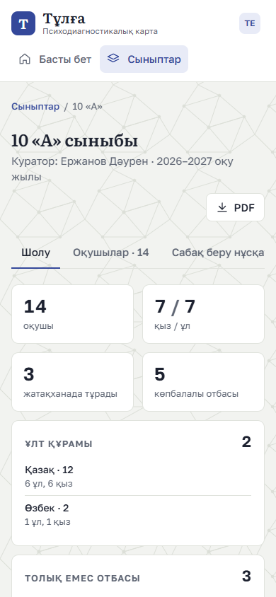</td>
  </tr>
</table>

## Әзірлеушілерге

Техникалық сипаттама [ағылшын нұсқасында](README.md#for-developers).

**Стек:** TypeScript. Серверде NestJS, TypeORM және PostgreSQL; браузерде React, Vite, TanStack Query және Tailwind CSS. Мектептің өз Windows Server-інде, мектеп желісінің ішінде жұмыс істейді.

## Осы репозиторий туралы

Бұл бет жобаны көрсетеді. Бастапқы код жабық, себебі ол балалардың психологиялық деректерімен жұмыс істейді. Кездескенде көрсетуге дайынмын.

[Демо](https://aibekser.github.io/tulga-showcase/) нақты веб-қосымшаның құрастырылған нұсқасы, ол ойдан шығарылған мектептен жазып алынған жауаптарды оқиды. Сервері жоқ, мектепке қосылмаған, сондықтан өзгерістер сақталмайды, файл жүктеу мен Excel өшірулі, ал күн 2026 жылғы 5 қарашада тұрып қалған. Оқушылардың суреті жоқ, ал ЖСН орнына ешкімде болмайтын сандар тұр. Сыныпты басып шығару және PDF ретінде сақтау нақты нұсқадағыдай жұмыс істейді.

Жобаны мектеп бағдарламашысы **Айбек Серікбай** жасады, [Claude Code](https://claude.com/claude-code) жасанды интеллект көмекшісі ретінде қатысты.

© Aibek Serikbay. Барлық құқықтар қорғалған: код, суреттер мен мәтінді рұқсатсыз көшіруге немесе пайдалануға болмайды.
