# Тұлға

**A school psychologist's profile of every student, in one place every teacher can use.**

Built for [Nazarbayev Intellectual School](https://www.nis.edu.kz/) in Turkestan, Kazakhstan, where it is in pilot with its first class.

**[▶ Try the live demo](https://aibekser.github.io/tulga-showcase/)**: sign in as the psychologist, a teacher, a curator, the vice principal or the administrator, and click around.

[Қазақша нұсқасы](README.kk.md)

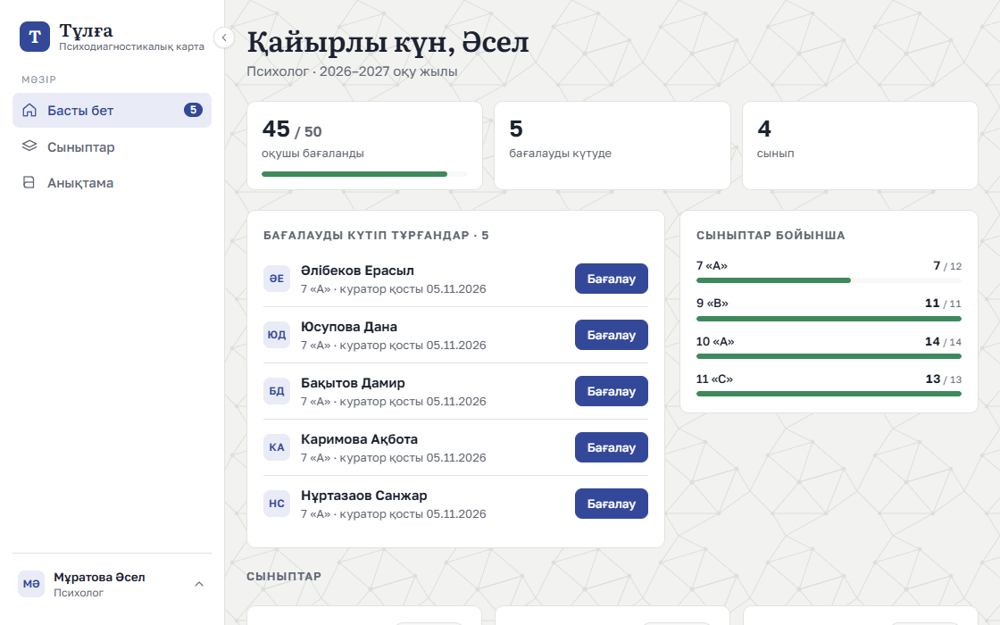

Every name, score and text in these images is invented. They come from a demo school generated for this page, so no real student or staff member appears. The interface is in Kazakh because that is the language of the school.

## The problem

A school psychologist assesses each student: temperament, how they best take in information, type of intelligence, personality type and motivation. That is useful to every teacher who stands in front of the class.

But the results lived in slides made by hand for each class. Teachers rarely saw them, and whenever a student joined or a new school year began, the slides were out of date.

## The result

The psychologist enters an assessment once. The class charts, the advice for teachers, the printable profile and the yearly hand-over all follow from it, and every teacher can open any class.

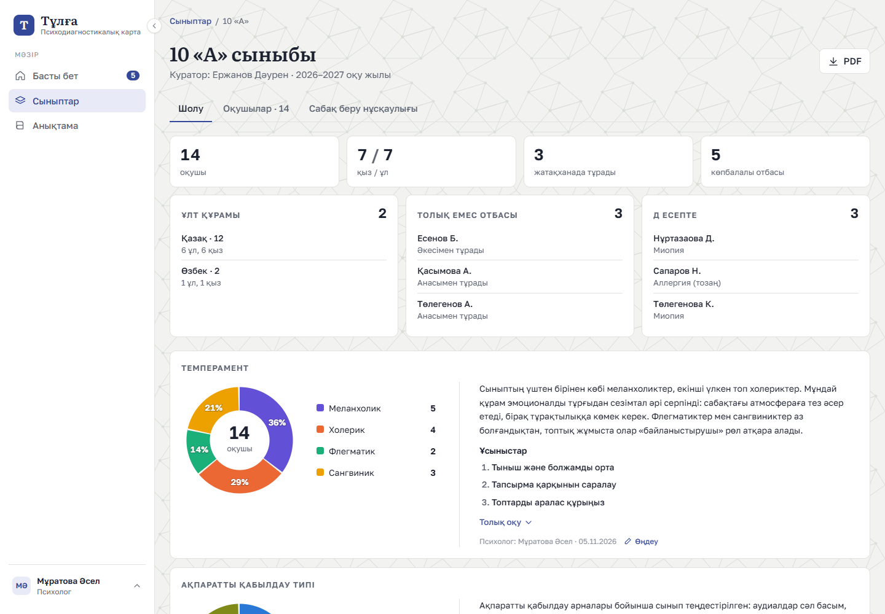

It also comes in a dark theme and works on phones.

## Who uses it

### The psychologist: "Who is still waiting, and what should I tell the teachers?"

Their home page is a to-do list: students a curator has added who haven't been assessed yet. The form takes the five types and the texts, and one click fills in a starting text from the chosen types, which the psychologist then adapts to the child. The conclusions under a class's charts are written by the psychologist too, not generated, because they know the class.

<table>
  <tr>
    <td>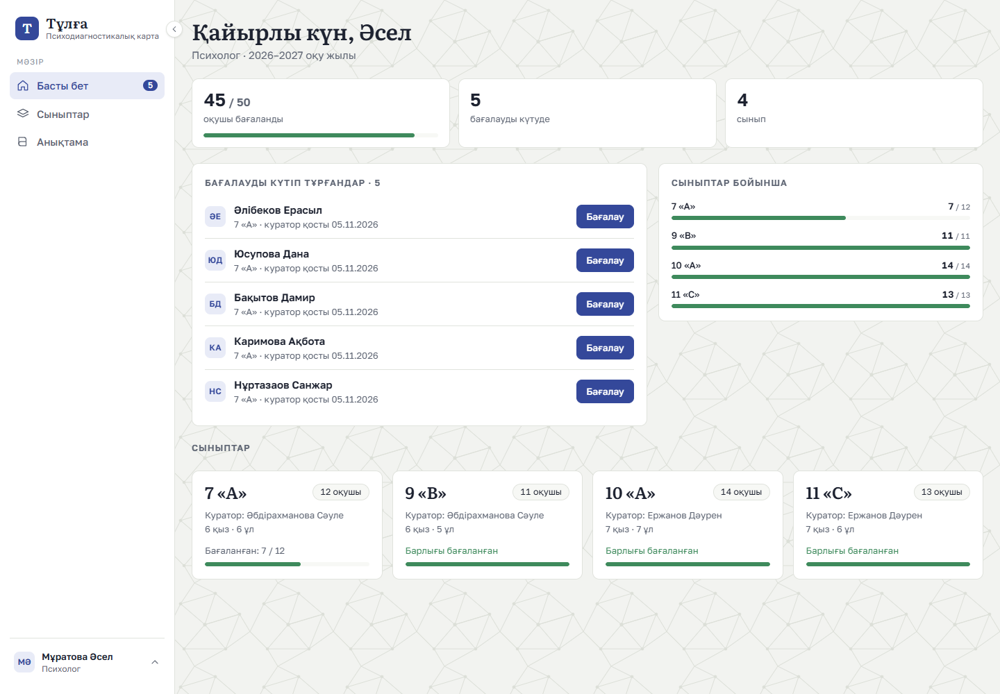</td>
    <td>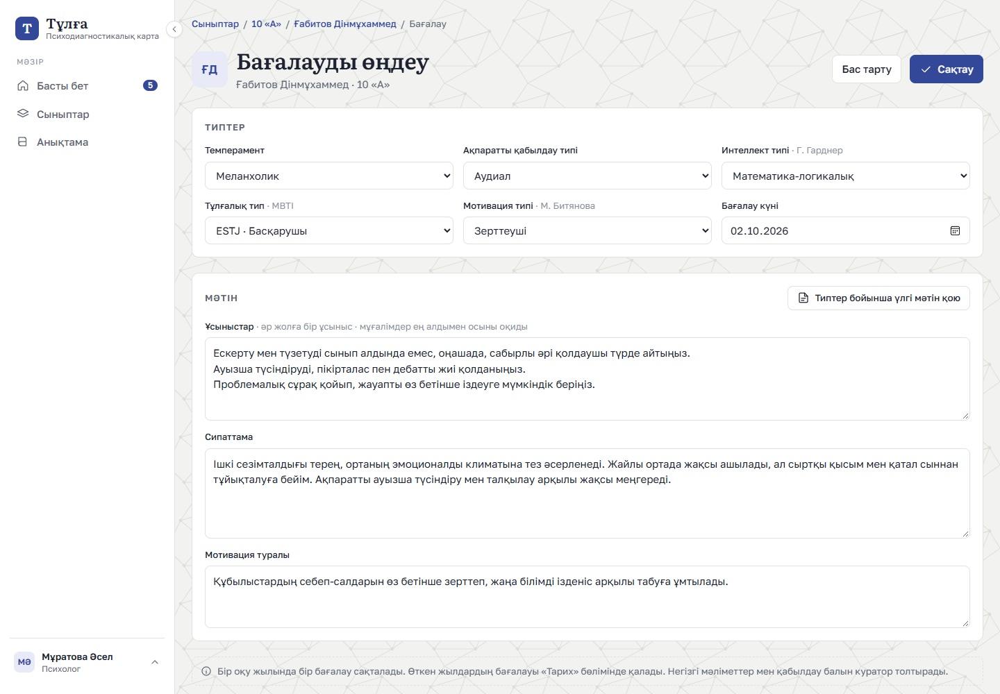</td>
  </tr>
</table>

### Teachers: "I have a lesson in five minutes"

On a student's profile, the recommendations come first, because that is what a teacher needs before a lesson. The teaching guide groups a whole class by what the students need, with advice for each group, and can be read in a minute.

<table>
  <tr>
    <td>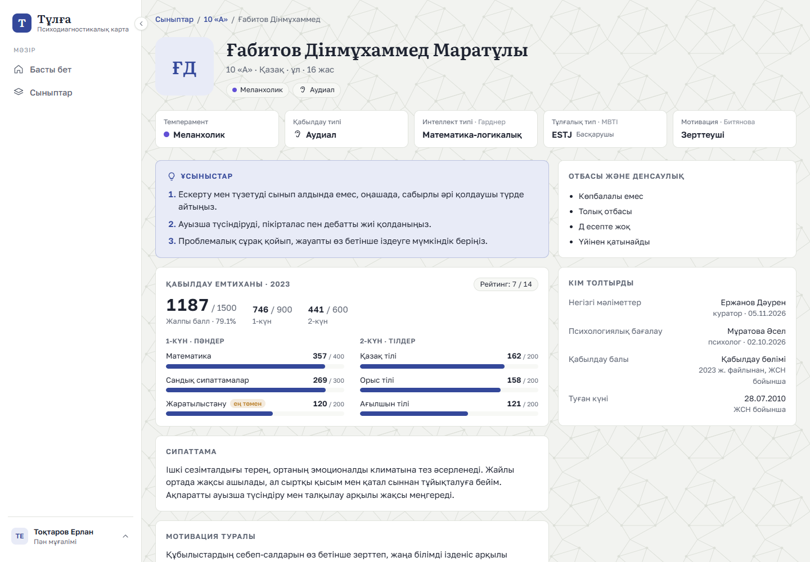</td>
    <td>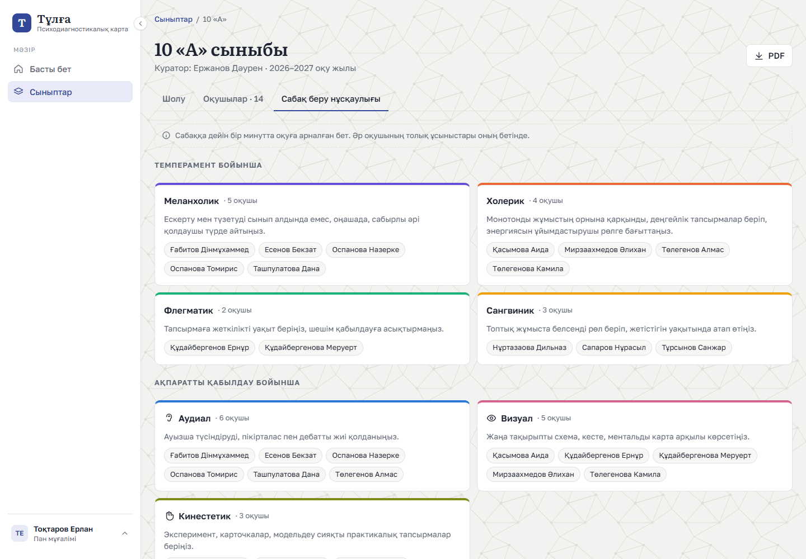</td>
  </tr>
</table>

### Curators: "My class's list is up to date"

A curator, the teacher responsible for a class, adds students one by one or the whole class from an Excel file, with a preview of every row before anything is saved.

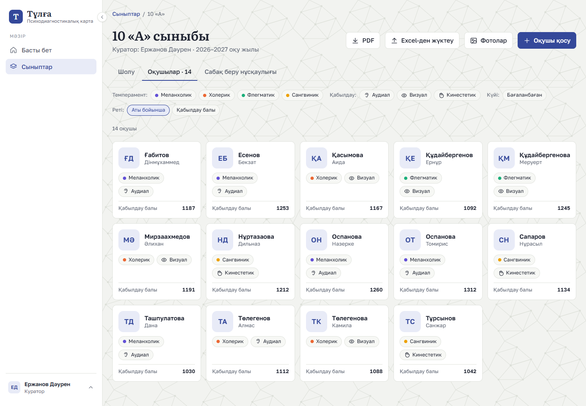

### The vice principal: "I need this on paper for a meeting"

One button turns a class page into an A4 document: the class makeup, every chart with the psychologist's full conclusion, and a page per student. Medical details can be left out when the document leaves the school.

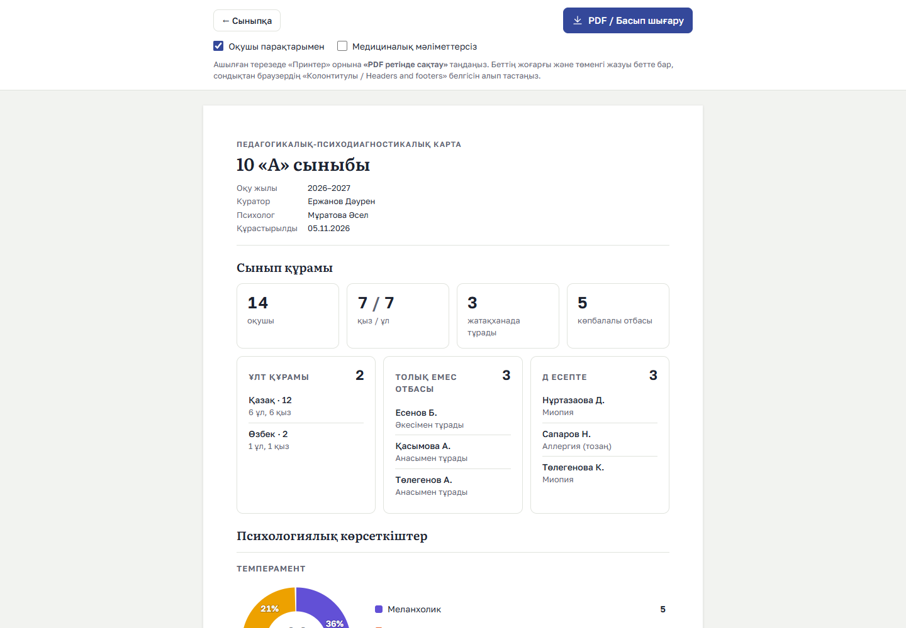

### The administrator: access and the school year, but never the profiles

Only people on the list can sign in, with their school account. Every sign-in, opened profile and change goes to a log nobody can edit. At the end of the year, one guided step moves every class up a grade and keeps the old year as a read-only archive. The administrator manages all of this without being able to open a single student's profile.

<table>
  <tr>
    <td>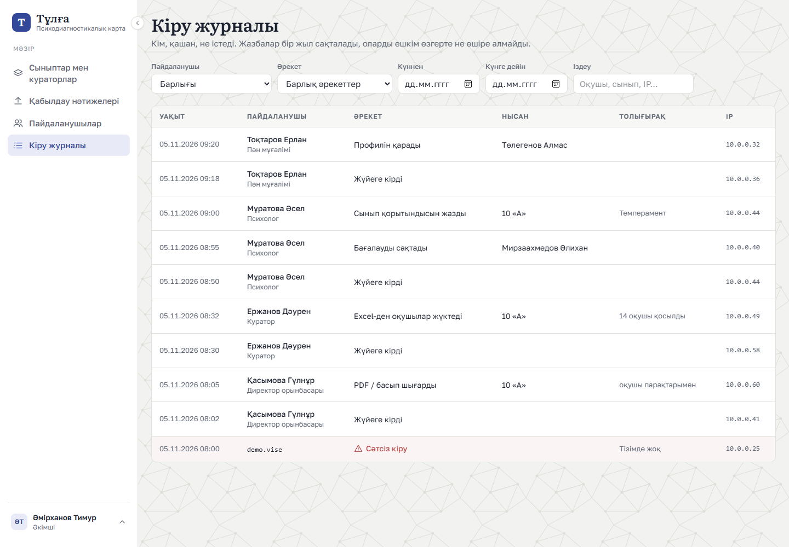</td>
    <td>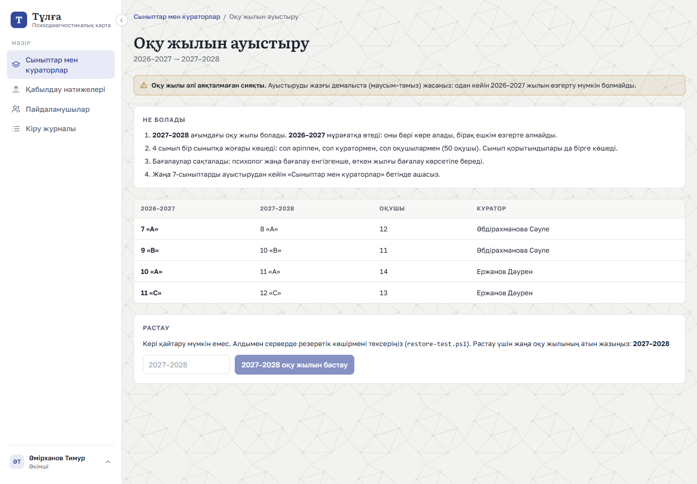</td>
  </tr>
</table>

<table>
  <tr>
    <td>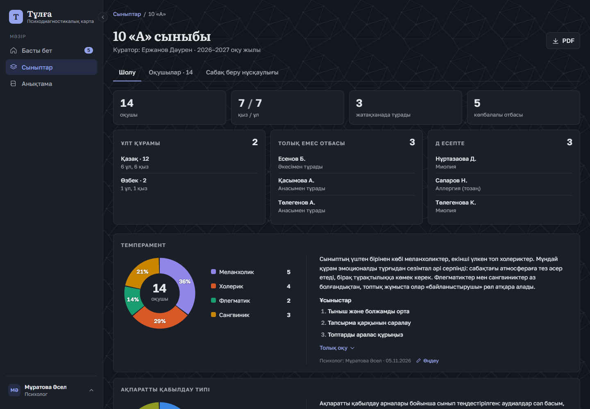</td>
    <td width="25%">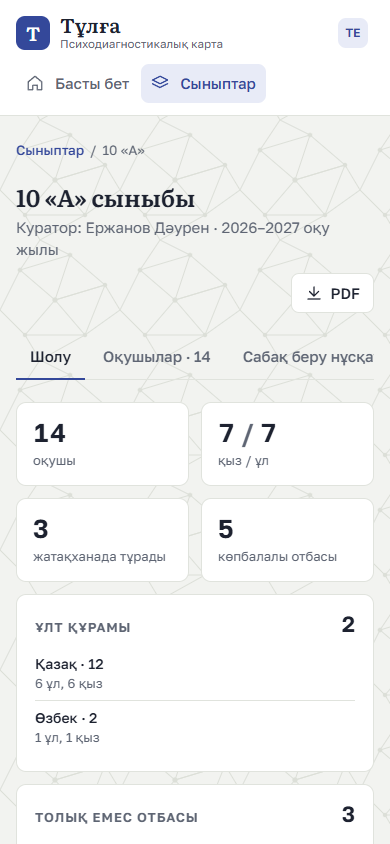</td>
  </tr>
</table>

## For developers

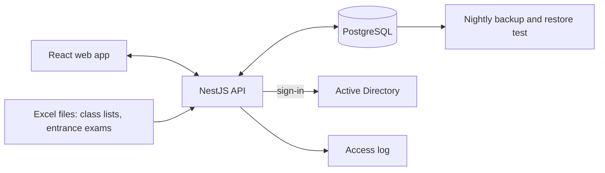

**Stack:** TypeScript throughout. NestJS, TypeORM and PostgreSQL on the server; React, Vite, TanStack Query and Tailwind CSS in the browser. It runs on the school's own Windows Server inside its network, as one process on one port, with fonts bundled so it needs no internet.

Some problems that were more interesting than they look:

- **Sensitive data, many readers.** Psychological and medical details about children need strict limits, yet the whole point is that teachers can read them. So each role sees only what it needs, the check happens on the server for every request, and removing someone takes effect at once. The administrator, who controls access, cannot see profiles at all.
- **A school year that moves on.** An assessment shouldn't vanish because a student moved up a grade. The latest one simply keeps applying until the psychologist saves a new one, so nothing is copied or goes stale, and past years stay exact as an archive.
- **An irreversible step made safe.** The year change runs in one database transaction, shows a preview of every class first, and asks you to type the new year's name. Graduates are kept for one more year and then deleted by a person, never silently.
- **A log that can't break anything.** Recording an action can never make the action itself fail, and lines are kept for one year and then removed automatically.
- **Careful with Excel.** National ID numbers are checked digit by digit, birth date and gender are read from them, and entrance exam results find their student by that number rather than by a name that may be spelled differently.
- **The same page, on paper.** Charts size themselves to their container, so the A4 sheet you see on screen is the sheet that prints. Paper is always light, even in dark mode.
- **A backup you've actually tried.** A script restores the newest nightly backup into a scratch database and checks it, because a backup nobody has restored is only a hope.

## About this repository

This page shows the project. The source code is private because it handles children's psychological data; I'm happy to walk through it in person.

The [live demo](https://aibekser.github.io/tulga-showcase/) is the real web app in compiled form, reading answers recorded from an invented school. It has no server and no connection to the school, so changes aren't saved, uploads and Excel files are off, and the date stays on 5 November 2026. Students have no photos, and national ID numbers are replaced with numbers no person can have. Printing and saving a class as a PDF work as in the real thing.

Designed and built by **Aibek Serikbay**, the school's programmer, with [Claude Code](https://claude.com/claude-code) as an AI pair programmer.

© Aibek Serikbay. All rights reserved: the code, images and text may not be copied or reused without permission.
